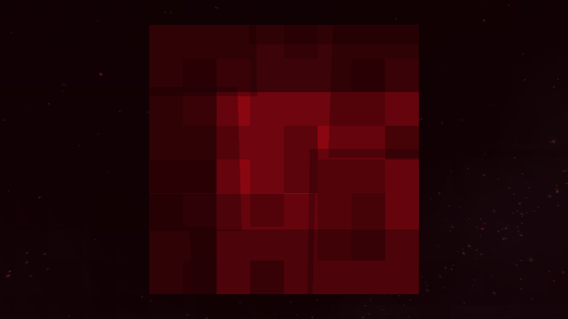
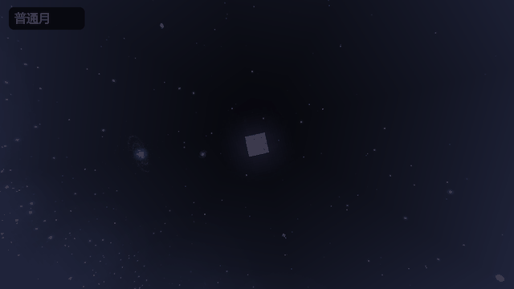
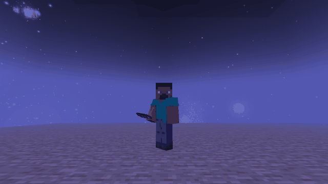

# 月魇 · Lunar Dread

十六月相 · 活体血月 · 异常生物 · 独立运行

Minecraft 1.21.1 ｜ NeoForge 21.1.265 ｜ Java 21 ｜ 预览版 0.12.0

[下载模组](https://github.com/vdjango/lunar-dread/releases/tag/v0.12.0) · [反馈问题](https://github.com/vdjango/lunar-dread/issues) · [项目主页](https://github.com/vdjango/lunar-dread)

## 模组介绍

**月魇**是一款以月相变化为核心的恐怖生存模组，加入 16 种月相、血月浓雾、异常重力和原创生物。不同月相会带来不同的增益与危险，既有适合收集物资的夜晚，也有需要躲避追猎、互相救援的夜晚。

**单独安装即可自动运行，无需其他模组或数据包。**支持单人和多人游玩，可选择概率触发或百日进程。首次进入世界会获得《求生手册》和《月相异闻录》，在游戏中就能查看生存提示。

## 玩法看点

- **16 种月相**：丰收月、蓝月带来收益；血月、紫狱月、倒悬月等拥有各自的事件与遭遇。
- **活体血月**：月面脉动、心跳声、凝望追猎，以及带有预警的月面射线。
- **地表与洞穴雾效**：雾气随入夜渐浓，黎明散去；高处、地表与地下的视野各不相同。
- **失重与救援**：异常重力会让实体漂浮、视角翻滚；队友可用鱼钩协助救援。
- **原创生物与异常动物**：追击、掳走、挖掘、窥视等遭遇，攻击带有前摇与冷却。
- **守卫补给**：货箱从空中降落，提供坐标与方向指引，击败守卫后领取物资。

[查看十六月相独立动图](https://github.com/vdjango/lunar-dread/blob/v0.12.0/docs/images/moons/README.md) · [下载 GIF 素材包](https://github.com/vdjango/lunar-dread/releases/download/v0.12.0/lunar-dread-0.12.0-moon-gifs.zip)

## 两种玩法

| 模式 | 玩法 |
| --- | --- |
| **概率模式 · 随时开玩** | 独立安装默认使用。每晚有 35% 概率出现特殊月相，其余为普通月；不限天数，事件强度不随存档年龄增加。 |
| **百日模式 · 逐周挑战** | 五天一周，难度逐周提升。前五天准备，第十天起每五天血月，血月后两晚休整，第 100 天巨月；百日结束后停止自然事件。 |

**两种模式都能独立游玩。**《百日围城·断墙之夜》默认使用百日模式，并保留整合包配套玩法；单独安装不会附带整合包里的其他模组。

| 房主命令 | 作用 |
| --- | --- |
| `/lunardread mode` | 查看当前模式 |
| `/lunardread mode probability` | 切换为概率模式 |
| `/lunardread mode hundred_days` | 切换为百日模式 |

切换需要管理员权限，保留当前世界日期；每晚的月相随世界保存，重启不会重新抽签。

## 安装说明

**Minecraft 1.21.1 / NeoForge，Java 21。暂无 Forge、Fabric 版本。**

1. 创建 NeoForge 21.1.265 实例。
2. 将 `lunar-dread-0.12.0.jar` 放入 `mods` 文件夹，进入世界即可自动运行。
3. 多人游戏时，客户端与房主或服务端都安装月魇，版本保持一致。

**旧版玩家：**0.12.0 起，Enhanced Celestials、Stellar View、Zombies Break & Build、The Hordes 均为可选兼容，不再是月魇的必需前置。

## 常用配置

首次运行后生成配置文件。`true` 为开启，`false` 为关闭；修改前退出游戏，保存后重新进入。

### 个人画面与声音

文件：`config/lunar_dread-client.toml`

| 配置项 | 默认值 | 作用 |
| --- | --- | --- |
| `visuals.moonFogEnabled` | `true` | 开关月相雾效 |
| `visuals.bloodFogPeakDistance` | `7.0` | 血月地表可见距离，数值越大看得越远 |
| `visuals.bloodCaveFogDistance` | `5.0` | 血月地下可见距离，数值越大看得越远 |
| `audio.tensionMusicEnabled` | `true` | 开关紧张配乐 |

### 世界规则

文件：实例的 `config/lunar_dread-server.toml`，由房主或服主修改，联机玩家自动使用同一规则。

| 配置项 | 默认值 | 作用 |
| --- | --- | --- |
| `calendar.mode` | `PROBABILITY` | 概率模式；改为 `HUNDRED_DAYS` 使用百日模式 |
| `probability.eventChance` | `0.35` | 每晚特殊月相总概率，0.35为35% |
| `probability.graceDays` | `0` | 开局保护天数，0表示第一晚即可触发 |
| `probability.repeatGap` | `2` | 同一种特殊月相至少间隔几晚 |
| `probability.difficultyDay` | `30` | 概率模式的固定强度，范围6–100 |
| `probability.giantChance` | `0.25` | 抽中血月时，有25%概率直接出现巨月 |
| `encounters.horrorEnabled` | `true` | 开关原创恐怖遭遇 |
| `moon.heartbeatEnabled` | `true` | 开关血月心跳声 |
| `animals.chaseDurationScale` | `1.0` | 异常动物追击时长倍率，越小越短 |

**挑选月相：**`[probability.weights]` 下的数值决定各月相出现的比例，设为 `0` 可禁用对应月相，例如 `blood = 0` 禁用概率血月。这些概率设置只作用于概率模式。

表中的 `visuals.xxx` 表示 `[visuals]` 分组下的 `xxx`，其他分组同理。心跳等敌对音效也可通过游戏内的“敌对生物”音量调整。

## 下载与反馈

[前往下载](https://github.com/vdjango/lunar-dread/releases) · [提交问题](https://github.com/vdjango/lunar-dread/issues)

反馈时请附上游戏版本、月魇版本、日志或截图，方便定位问题。

作者：**BuggCraft** · 月魇代码采用 **MIT** 协议。
