

# Lunar Dread · 月魇

**让月亮成为夜晚最不安的存在。**

[源码](https://github.com/vdjango/lunar-dread) · [发行版](https://github.com/vdjango/lunar-dread/releases) · [报告问题](https://github.com/vdjango/lunar-dread/issues) · [参与贡献](CONTRIBUTING.md)

Lunar Dread 是面向 **Minecraft 1.21.1 / NeoForge** 的月相恐怖模组。月亮会改变夜晚的光线、重力与遭遇：血雾遮住地面，巨月像活物一样搏动，异常生物循着玩家的声音与足迹接近。攻击保留前摇、遮挡判定与冷却，给玩家观察、躲避和救援的机会。

## 实机预览

Minecraft 1.21.1 客户端实拍：月相、失重、异体、动物技能与空投。GIF 无声，可[试听心跳](docs/audio/heart.ogg)。

| 十六月相 | 巨月心跳 |
|---|---|
| 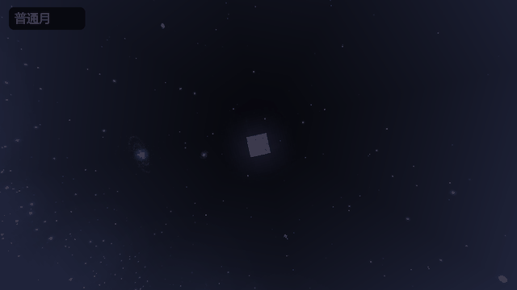 | 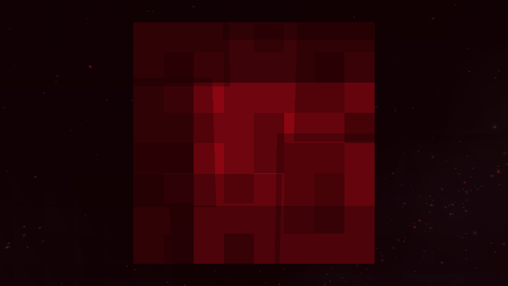 |
| 血月浓雾 | 深红月面射线 |
| 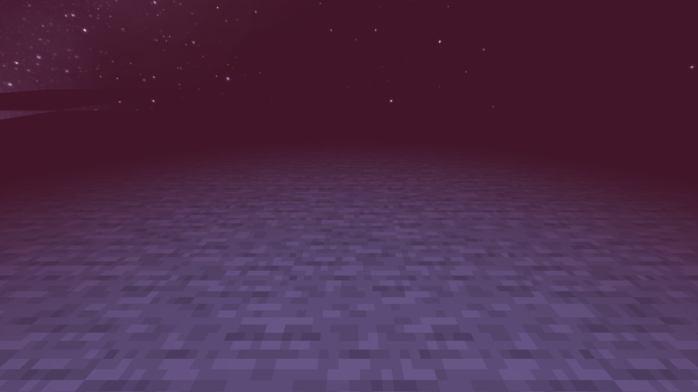 | 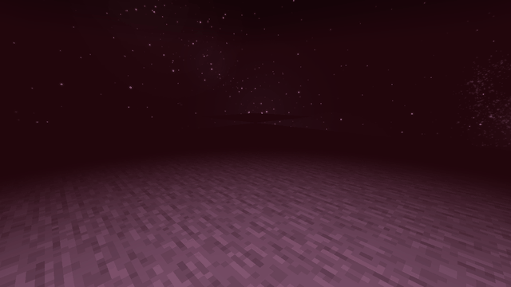 |
| 失重翻滚 | 怪物掳走 |
| 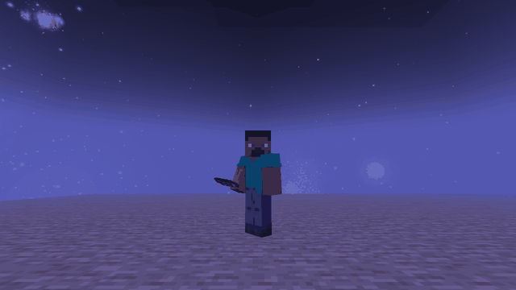 | 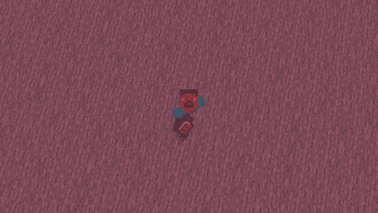 |
| 原创恐怖实体 | 月相专属异体 |
| 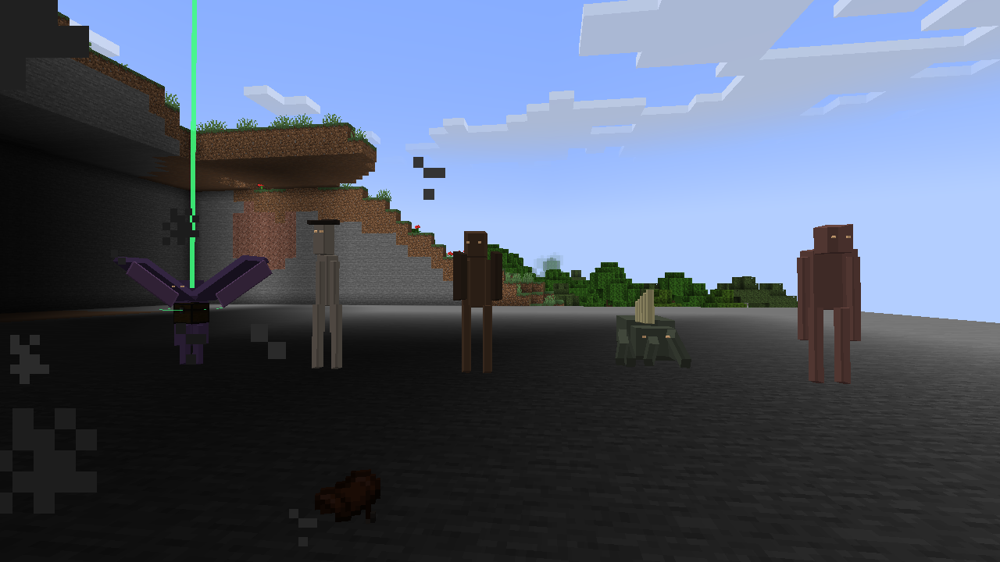 | 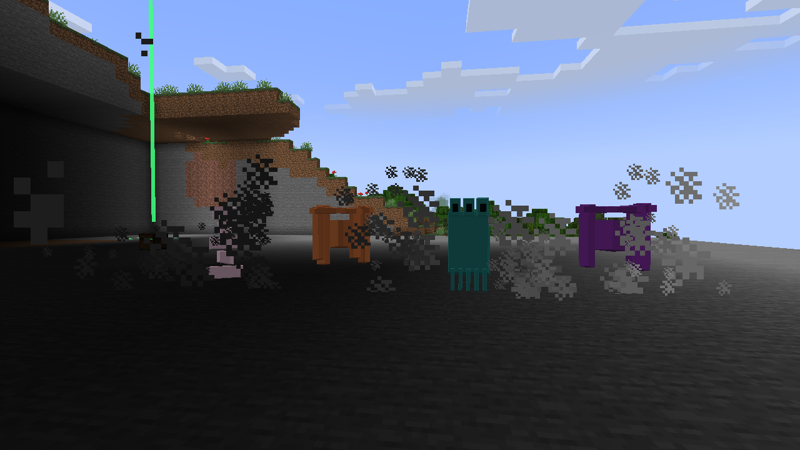 |
| 山羊喷火 | 绵羊吐 TNT |
| 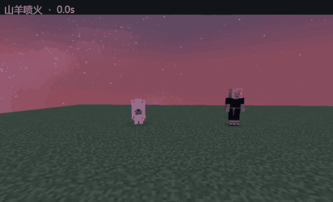 | 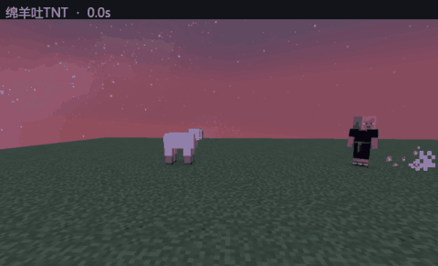 |
| 羊驼扇形 TNT | 鸡的危险蛋 |
| 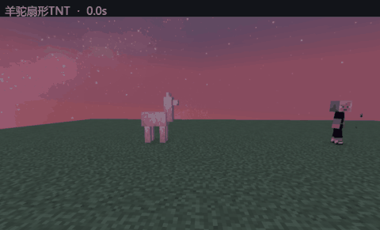 | 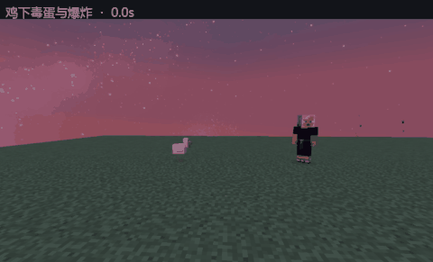 |
| 常态血月 | 降落的补给货箱 |
| 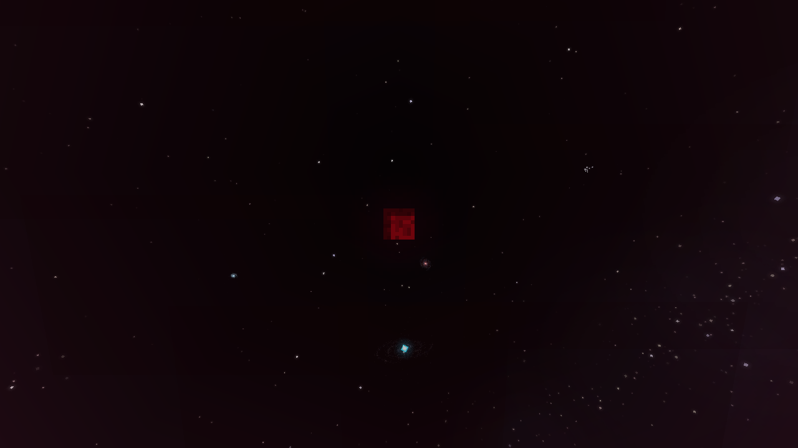 | 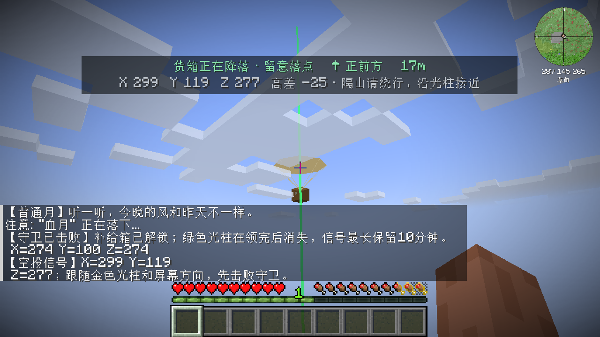 |

## 功能

- **16 种月相**：和平增益、血月与主题异变，支持管理员手动切换。
- **活体血月**：常态与巨月形态、月面脉动、沉闷心跳、凝望追猎与带预警的月面射线。
- **异常重力**：实体失重、横向姿态、视角翻滚、漂浮物与队友的鱼钩救援。
- **原创遭遇**：追猎、掳走、挖掘、屋檐窥视、空中追击及月相异体。
- **异常动物**：基于原生实体 AI 的追击、前摇和技能，限制距离、冷却与数量。
- **守卫空投**：真实降落的货箱、坐标和方向指引、击败守卫后领取武器与物资。
- **两本手册**：求生手册说明生存准备；彩字《月相异闻录》介绍十六种月相。
- **声音和配置**：空间音效、紧张配乐、TOML 配置与 /lunardread 管理工具。

## 安装

当前目标版本为 **Minecraft 1.21.1、NeoForge 21.1.265、Java 21**。尚无 Fabric 或 Forge 构建。

| 必需依赖 | 已验证版本 | 安装位置 | 用途 |
|---|---|---|---|
| Enhanced Celestials | 6.0.2.6 | 客户端和主机/服务端 | 基础月相接口、丰收月与蓝月收益 |
| Stellar View | 0.5.3 | 客户端 | 月面与天空渲染衔接 |
| Zombies Break & Build | 1.7.0 | 客户端和主机/服务端 | 方块破坏与搭建事件桥接 |
| The Hordes | 1.6.3f | 客户端和主机/服务端 | 围城与感染系统桥接 |

同时安装这些模组声明的前置库，例如 CorgiLib、Data Anchor。当前版本仍直接使用外部月相接口与渲染兼容层，不能移除 Enhanced Celestials 或客户端 Stellar View。

1. 创建对应版本的 NeoForge 实例，安装上述依赖。
2. 从发行版获取或自行构建 lunar-dread-*.jar，放入 mods/。
3. 启动后确认模组列表显示 **Lunar Dread | 月魇**。
4. 单人游戏由集成服务器执行世界逻辑；局域网与专用服务器需要客户端和主机版本一致。

**可选物品兼容**：安装 Musket Mod 后，强化空投可提供火枪及纸壳弹药；安装 Jungdab's Turrets 后可提供炮塔弹药。两者不是月魇的加载依赖，未安装时使用原版武器与箭矢。

## 月相

管理员使用 /lunardread moon set &lt;id&gt; 指定月相。

所有月相都有自己的雾色。雾在入夜后渐浓，午夜最重，黎明散去；血月最浓时地表只能看清约 7 格，地下更近。月面不受地面雾遮挡。

| ID | 月相 | 主要效果与遭遇 |
|---|---|---|
| normal | 普通月 | 常规月夜与基础遭遇。 |
| harvest | 丰收月 | 衔接 Enhanced Celestials 的丰收收益。 |
| blue | 蓝月 | 衔接 Enhanced Celestials 的幸运与收集收益。 |
| wind | 旅风月 | 青色月面，短时移动加速。 |
| green | 翠息月 | 绿色月面，挖掘加速与周期性饱食收益。 |
| star | 星砂月 | 蓝白月面，限量小型补给。 |
| blood | 血月 | 红雾、凝望与追猎，可切换巨月。 |
| purple | 紫狱月 | 裂隙核心与缝合异体。 |
| pale | 苍白月 | 聆听者与空壳，对声响作出反应。 |
| mirror | 黑镜月 | 镜中异体沿近期路径接近。 |
| gravity | 倒悬月 | 局部失重、漂浮物与视角翻滚。 |
| amber | 琥珀月 | 延迟残影重演路线并突袭。 |
| tide | 青潮月 | 空间潮汐推移和减速玩家。 |
| rust | 锈雨月 | 磁簇牵引与锈蚀主题攻击。 |
| paper | 纸幕月 | 假象与幕后的异体。 |
| ash | 灰烬月 | 灰烬雾中出现火焰守卫；地面火圈预警后坠下余烬。 |

和平月仍保留普通生存风险。

## 命令

输入 /lunardread 查看简要帮助。管理命令需要权限等级 **2**；单人世界需开启作弊。尖括号表示必填，方括号表示可选，玩家参数支持选择器。

    /time set night
    /lunardread moon set blood
    /lunardread moon form giant
    /lunardread event trigger moon.strike @a[gamemode=survival]
    /lunardread moon auto

| 命令 | 说明 |
|---|---|
| /lunardread moon list | 列出全部月相 ID。 |
| /lunardread moon status | 查看当前月相、形态和进度。 |
| /lunardread moon set &lt;id&gt; | 指定月相；白天设置后于夜间呈现。 |
| /lunardread moon auto | 恢复自动调度。 |
| /lunardread moon form &lt;normal或giant&gt; | 切换血月形态。 |
| /lunardread moon awaken | 测试巨月苏醒。 |
| /lunardread moon lift | 测试失重升空。 |
| /lunardread moon contact | 测试近月接触。 |
| /lunardread event list | 列出全部事件 ID。 |
| /lunardread event trigger &lt;id&gt; [players] | 触发事件，保留前摇、数量与环境限制。 |
| /lunardread event cancel | 结束正在进行的月相异变和攻击。 |
| /lunardread animal &lt;entity&gt; &lt;action&gt; &lt;player&gt; | 让指定野生动物对玩家准备技能。 |

事件 ID 和动物技能目录

| 类别 | ID |
|---|---|
| 月面与玩家 | moon.strike、moon.gaze、moon.blackout、moon.gravity、moon.contact、blood.hunt、air.raid、player.cure |
| 空投 | supply.guarded、supply.rich、supply.star |
| 主题异变 | anomaly.purple、anomaly.pale、anomaly.mirror、anomaly.amber、anomaly.tide、anomaly.rust、anomaly.paper、anomaly.ash |
| 基础异体 | creature.skin_hauler、creature.spine_digger、creature.bent_beam、creature.eave_watcher、creature.tether_wing |
| 月相异体 | creature.rift_warden、creature.stitched_beast、creature.listener、creature.hollow、creature.reflection、creature.late_shadow、creature.tide_walker、creature.chorus、creature.magnet_cluster、creature.porter、creature.backstage_hand、creature.paper_walker、creature.star_jelly、creature.suspended |

动物 action：goat_fire、goat_ram、goat_trap、sheep、llama、chicken、cow、pig、rabbit、wolf、fox、cat、bee、hoof、panda、bear、frog、turtle、axolotl、bat、squid。

选择技能匹配、有 AI 的成年野生动物；目标必须是同世界、16 格内可见的生存玩家。恢复夜、驯服状态等限制仍生效。

### 补给、手册与音效

| 命令 | 权限 | 说明 |
|---|---|---|
| /lunardread supply locate | 玩家 | 查看空投坐标并显示导航。 |
| /lunardread supply track | 玩家 | 切换方向指引。 |
| /lunardread supply spawn | 管理员 | 寻找已加载的落点并投放。 |
| /lunardread guide | 玩家 | 获取求生手册。 |
| /lunardread guide moon | 玩家 | 获取彩字《月相异闻录》。 |
| /lunardread sound test &lt;id&gt; | 玩家 | 试听指定音效。 |
| /lunardread config | 管理员 | 查看服务端配置。 |

可试听的声音 ID：heart、tension、whisper、rift、scrape、grab、silence。心跳与效果音受“敌对生物”音量影响。

首次进入世界时会收到两本书。两本书均由 Lunar Dread 自行生成；月相书的文字和颜色位于 resources/lunar_dread/moon_codex.json。

## 空投奖励

空投保留守卫、降落过程、坐标与光柱指引。普通与强化空投包含少量金属、红石和食物；炮塔模组存在时附带炮塔弹药。

| 类型 | 早期奖励 | 第 30 天及以后 |
|---|---|---|
| 小型/星砂补给 | 弓 ×1、箭 ×12 | 保持基础补给 |
| 普通守卫空投 | 弓 ×1、箭 ×16、炮塔弹药 ×16（可选） | 弩替代弓 |
| 强化/血月空投 | 燧发手枪 ×1、纸壳弹药 ×12、箭 ×24、炮塔弹药 ×32（可选） | 火枪 ×1、纸壳弹药 ×20，另有少量稀有材料 |

未安装 Musket Mod 时，强化空投改给弩及额外箭矢。空投不提供完整炮塔，武器不带额外附魔。

## 配置

NeoForge 首次加载后生成 config/lunar_dread-server.toml 和 config/lunar_dread-client.toml。世界的 serverconfig/ 可覆盖服务端配置；修改后重启世界可确保全部选项生效。

| 文件 | 配置键 | 默认值 | 用途 |
|---|---|---|---|
| server | animals.enabled | true | 异常动物行为开关 |
| server | animals.chaseDurationScale | 1.0 | 追击时长倍率，0.5–2.0 |
| server | encounters.horrorEnabled | true | 原创恐怖遭遇开关 |
| server | moon.heartbeatEnabled | true | 心跳开关 |
| server | moon.heartbeatVolumeScale | 1.0 | 心跳音量倍率，0.0–2.0 |
| server | books.survivalGuideOnFirstJoin | true | 首次进入时发放求生手册 |
| server | books.moonCodexOnFirstJoin | true | 首次进入时发放月相书 |
| client | audio.tensionMusicEnabled | true | 紧张配乐开关 |
| client | audio.tensionMusicVolumeScale | 1.0 | 配乐音量倍率，0.0–2.0 |
| client | visuals.moonFogEnabled | true | 月相地面雾开关 |
| client | visuals.moonFogDistanceScale | 1.0 | 非血月雾视距倍率，0.5–2.0 |
| client | visuals.bloodFogPeakDistance | 7.0 | 血月浓雾峰值地表视距，4–24 格 |
| client | visuals.moonRayWidthScale | 1.0 | 月面射线宽度倍率，0.5–2.0 |

管理员可在游戏中保存部分配置：

    /lunardread config set animals true
    /lunardread config set horror true
    /lunardread config set chase 0.75
    /lunardread config set heartbeat true
    /lunardread config set heartvolume 1.25

## 从源码构建

需要 **Python 3.10+、Java 21 JDK**，以及本机已安装并生成运行库的 NeoForge 21.1.265 客户端和专用服务器。当前用 Python 调用 JDK 编译；仓库不包含 Gradle Wrapper。

    git clone git@github.com:vdjango/lunar-dread.git
    cd lunar-dread

将以下原始 JAR 放入本地依赖目录，每种只保留一个匹配版本：Enhanced Celestials、Stellar View、CorgiLib、Data Anchor、The Hordes、Zombies Break & Build。构建脚本只读取这些文件，不下载或重新分发第三方模组。

PowerShell 示例：

    $env:JAVA_HOME = "C:/path/to/jdk-21"
    $env:LUNAR_DREAD_SERVER_LIBRARIES = "C:/path/to/neoforge-server/libraries"
    $env:LUNAR_DREAD_MINECRAFT_LIBRARIES = "C:/path/to/.minecraft/libraries"
    $env:LUNAR_DREAD_DEPENDENCY_DIR = "C:/path/to/dependency-jars"
    python build.py

Linux/macOS 示例：

    export JAVA_HOME=/path/to/jdk-21
    export LUNAR_DREAD_SERVER_LIBRARIES=/path/to/neoforge-server/libraries
    export LUNAR_DREAD_MINECRAFT_LIBRARIES=/path/to/.minecraft/libraries
    export LUNAR_DREAD_DEPENDENCY_DIR=/path/to/dependency-jars
    python3 build.py

输出为 dist/lunar-dread-0.11.4.jar。音效与材质已包含在 resources/，常规构建无需重新生成。

    src/lunar/dread/    Java 源码与客户端实现
    resources/         语言、声音、模型、Mixin 和手册
    META-INF/          NeoForge 元数据与依赖声明
    test/              隔离环境使用的回归夹具
    build.py           本地构建入口

## 已知限制

当前版本的自动事件读取 lunar_dread.sys 世界进度。单独安装时需要先初始化进度；独立日历尚未加入模组。完整依赖列表见[安装](#安装)。

## 问题反馈与贡献

请在 [Issues](https://github.com/vdjango/lunar-dread/issues) 提供版本、复现步骤、预期/实际行为，以及相关日志。提交 PR 前请阅读 [贡献指南](CONTRIBUTING.md)。请勿提交个人存档、账号信息、依赖 JAR 或构建产物。

## 许可与致谢

本项目代码采用 [MIT License](LICENSE)。感谢 Enhanced Celestials、Stellar View、Zombies Break & Build、The Hordes 及其维护者提供的接口与兼容基础。第三方项目的代码、资源与商标遵循各自许可，不属于本项目 MIT 授权范围。
